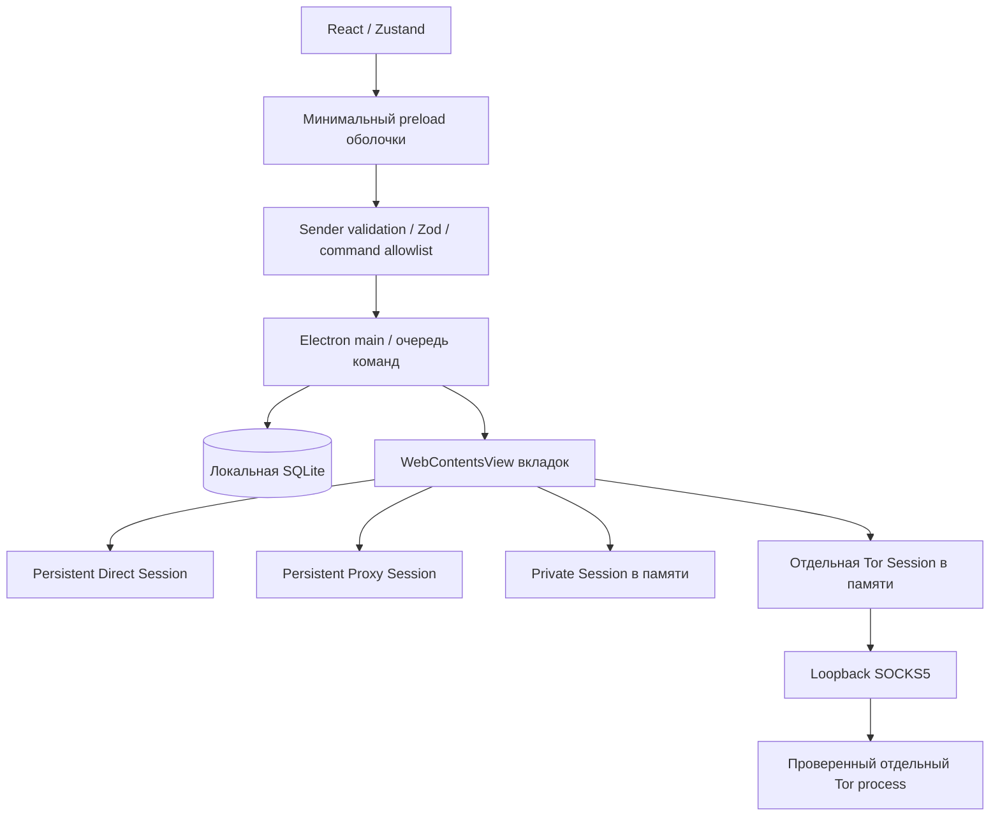

# Архитектура RainCode Browser 0.2.0

## Процессы и доверие

React/Vite рисует доверенную оболочку, а реальные сайты работают в отдельных Chromium `WebContentsView`. У страниц и browser chrome разные DOM и WebContents; iframe не используется для имитации браузера.

Главный процесс владеет URL, title, loading, профилями, навигацией, permissions и lifecycle. Renderer получает снимки состояния через ограниченный IPC, Zustand хранит отображаемый снимок. Payload проверяется Zod, отправитель должен быть доверенным главным фреймом интерфейса. Команды выполняются через очередь, чтобы быстрые Ctrl+T/W/Tab и запросы renderer не меняли состояние одновременно.

Основные модули: `src/main/main.ts`, `security.ts`, `shortcuts.ts`, `tab-history.ts`, `store.ts`, `developer.ts`, `tor.ts`, `tor-policy.ts`. Контракты — `src/shared/contracts.ts`, оболочка — `src/renderer`.

## Вкладки, Omnibox и маршруты

Каждой внешней вкладке соответствует WebContentsView. Main рассчитывает bounds ниже chrome, скрывает views за overlay и при внутренних страницах, уничтожает WebContents при закрытии. Ручной sleep/discard уничтожает view с возможностью восстановить URL/историю; это не обещание, что любой скрытый tab автоматически перестаёт выполнять все запросы.

Omnibox хранит отдельный draft во время редактирования; обновления браузерного состояния его не перетирают. Composition не вызывает преждевременный Enter. Локальные подсказки используют только историю/закладки. Native shortcuts обслуживают shell и страницы, учитывая layout, AltGr и composition. DOM-редактирование остаётся у поля.

У логических внутренних адресов отдельный allowlist: `raincode://newtab`, `history`, `recently-closed`, `workspaces`, `settings`, `privacy`, `network`, `tor`, `downloads`, `bookmarks`, `extensions`, `devpanel`, `system`, `licenses`, `about`. Они не отправляются DNS и не дают читать произвольные файлы. Ассеты интерфейса отдаются через ограниченную CSP схему `raincode-app://ui/`.

`tab-history.ts` сохраняет timeline для переходов через внутренние страницы, а Chromium navigation history используется для реальных документов. Сохраняются URL/title/index без Chromium pageState с формами и паролями. Recently Closed хранит ID, URL, title, favicon, время закрытия и историю для восстановления выбранной записи. Private/Tor в постоянное восстановление не входят.

## Storage и профили

SQLite с WAL и `synchronous=FULL` хранит browser state. Persistent partitions разделяют Direct/Proxy; Private/Tor непостоянны. Профили не переносят cookies при переключении режимов. SQLite не зашифрована; защита диска и локальной учётной записи относится к ОС.

Workspace — сохраняемый снимок URL, profileId, темы, заметок и snippets. Пространства с одним profileId разделяют storage. Полные workspace-контейнеры, отдельные layout/env/project metadata остаются Planned; выбранная локальная папка пока не является автоматически изолированным проектным sandbox.

## DevTools и локальная разработка

DevTools открываются для выбранного реального WebContents, с поддерживаемыми Electron режимами detach/undocked/right/bottom. Внутренний Developer Workspace явно выбирает внешнюю страницу; switching не заменяет target на UI. Ctrl+U открывает Chromium `view-source:` активного сайта.

Штатные панели Chromium дают Elements, Console, Network, Sources, Performance, Memory, Application и Security. RainCode не реализует их заново. Встроенный сетевой список ограничен метаданными; query values/credentials/fragments редактируются, HAR не включает bodies, headers и cookies. Полный HAR доступен через штатный Network DevTools по явному действию.

Локальная папка выбирается системным диалогом. Чтение файлов проверяет canonical path, компоненты пути, symlinks/junctions и размер; страницы не получают filesystem API. Snippet требует подтверждения, закреплён за выбранной страницей и проверяет смену navigation во время согласия.

Command runner запускает PowerShell на Windows или /bin/sh на Unix как отдельный процесс после системного согласия на каждую команду. Ограничены время, вывод, параллельность и наследуемое окружение. Это не PTY, не sandbox пользовательских команд и не автоматический запуск scripts проекта. Команда имеет права текущего пользователя; сайт не получает к ней IPC-доступ.

## Tor

Windows x64 использует проверенный Expert Bundle 15.0.26, Tor daemon 0.4.9.14. Подготовка выполняет OpenPGP verification; runtime сверяет pinned manifest и каждый файл. Запуск происходит только явно, через фиксированный executable без shell. Bootstrap и ошибки публикуются в состоянии.

Tor Session получает SOCKS5 до навигации, без прямого fallback, с запретом локальных сетевых адресов и устройственных permissions. Onion вне этого профиля отклоняется или после подтверждения открывается отдельной Tor-вкладкой. Глобальный resolver не разрешает onion; обычная настройка DoH остаётся общей для приложения, а не обещанием отдельного резолвера каждого профиля.

Страницы используют sandbox/context isolation и выключенный Node. Исключение в конфигурации Tor — `nodeIntegrationInSubFrames: true` для минимального preload во всех фреймах; `nodeIntegration: false` и `sandbox: true` остаются включёнными. Preload удаляет WebRTC/WebTransport constructors и не выдаёт bridge. E2E и реальный onion smoke проверили отсутствие Node/bridge/WebRTC в основном документе и cross-origin iframe. Дополнительный E2E покрывает srcdoc. Эти проверки не заменяют packet capture и повторную проверку на новых Electron. Подробнее: [TOR_MODE.md](TOR_MODE.md).

## Визуальный слой и выпуск

Дождь использует ограниченные particles/FPS, reduced motion, hardware adaptation и паузу при скрытом документе. Bokeh/glass/glow/cinematic и parallax отключаемы. На адресный текст не накладываются blur/transform; UI масштабируется размерами, а не глобальным CSS zoom. Часы обновляются по минутам только на видимой стартовой странице.

Локализация ru/en размещена в словарях интерфейса, Developer Workspace и Tor. Сцена локальная, без hotlink/удалённых шрифтов.

Vite/esbuild и electron-builder создают Windows-приложение. Подписи и updater пока отсутствуют, macOS/Linux не проверены, Tor binary интегрирован только для Windows x64. Расширения не устанавливаются; частичная поддержка upstream Electron API не означает паритет с Chrome Web Store. Итоги тестов — [TEST_REPORT.md](docs/release-validation.md), дальнейшие этапы — [ROADMAP.md](ROADMAP.md).

## Security Center и Split View — 0.5.3

Security Center показывает параметры именно тех объектов WebPreferences, которые были переданы конструкторам UI/remote WebContents. Они сохранены в WeakMap, не дублируются отдельными «безопасными» константами. Поддерживаемый API Electron не предоставляет public getLastWebPreferences; отчёт явно имеет preferenceSource=creation-options и не претендует на runtime/OS attestation. Проверяются известные опасные флаги и реально разные Session объекты у открытых профилей; при недостатке профилей isolation=null. Документация API: https://www.electronjs.org/docs/latest/api/web-contents.

permission.set — strict IPC с canonical HTTP(S) origin, profile ID, enum permission/decision; once дополнительно требует живой tab того же профиля/origin. Policy mutations invalidate pending native consent; persistent denies are checked before native prompts; revocation clears once only for matching WebContents. Ask/Block reload matching site pages to stop existing access (UI warns about forms). Tor permissions remain denied. Website screen capture remains denied independently of future AI capture.

Split IDs stable while focus changes activeTabId. Geometry from shared/split-view.ts is reused by renderer chrome and main native bounds; toolbar/control space is excluded from web pages. Both visible pane IDs are excluded from sleep. Pane actions are enum-limited and URL validation is unchanged. New pages use isolated zoom (same-origin zoom must not propagate): https://www.electronjs.org/docs/latest/api/web-contents. No second engine or cloned session is introduced. Split metadata is restored only for retained normal-profile web tabs, and closing split never destroys the other tab.

Remaining AI integration must use existing SecretStore, per-profile/origin/document operation/session consent, context preview+confirmation and bounded cancellable provider streams. No plaintext key or page context in BrowserState/settings/logs; no direct Node fetch for a Tor profile. Current audit AI state is explicitly not-connected; replace it with actual controller state when AI is implemented. Screenshots/Live/Compare remain unavailable rather than decorative controls.

# AI Page Context 0.5.5

`AiConsentGate` is the main-process, memory-only authority. Native read consent precedes a constant `executeJavaScriptInIsolatedWorld(1004)` collector; no page program or arbitrary caller script is accepted. Scope is profile/tab/origin/native-document UUID. Only visible Direct pages in the configured provider's profile qualify. Output is bounded and schema-validated, excludes form/script/hidden/editable/iframe data and URL path/query/fragment, and masks obvious token patterns. User reviews the exact upload payload; tickets expire60s and are consumed once. Cloud page upload also requires native confirmation. Page instructions are quoted untrusted data; model tools and filesystem/command actions are absent.

Navigation, destruction, crash, profile switch, Stop, screen lock and revoke invalidate grants/previews. Requests with page context abort if a source document ends. There is no mutation observer or background scan. Text from two visible split sources has independent read grants and is combined only on confirmed Send. Full code/console/network collection, image capture and Live remain separate future capabilities.
